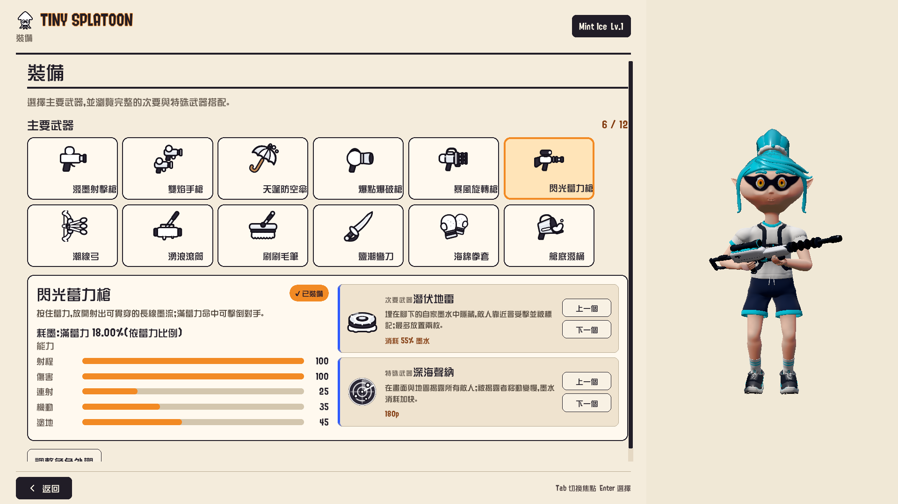
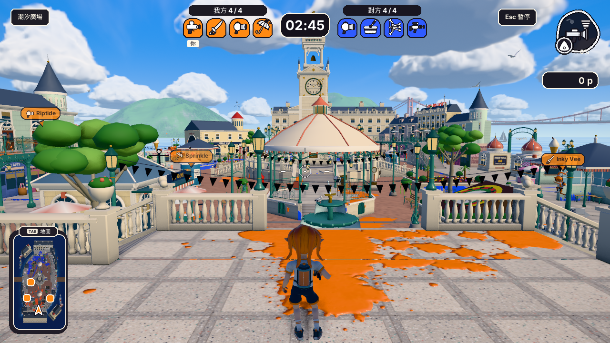
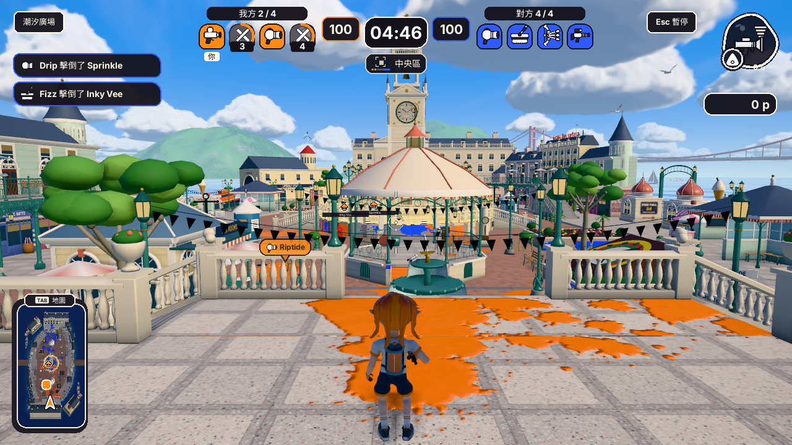

<div align="center">

# Tiny Splatoon

以 C++／OpenGL 還原的原生塗地射擊遊戲


[](https://github.com/SoWiEee/Tiny-Splatoon/actions/workflows/release.yml)

[下載遊戲](https://github.com/SoWiEee/Tiny-Splatoon/releases/latest) · [還原進度](docs/restoration-progress.md) · [目前實作規格](docs/spec.md) · [Old Demo](https://youtu.be/rS_o25PM3hM)

<sub>Old Demo 為原始期末專案影片；以下截圖為目前原生版本。</sub>

</div>

## 🎮 Features

- 離線 4v4 塗地、區域爭奪（Zones）、八人協力 Boss 與自由練習。
- 角色換裝、主／副／特殊武器、Bot AI 與固定 60 Hz 模擬。
- 連續墨水、動態場景、陰影／反射／後製與可保存的畫質、反鋸齒設定。
- 繁中介面、華康新綜藝體／BlitzMain、音樂與定位音效、玩家資料自動保存。
- GNS 私人房碼、八人 3D 大廳、自動游泳就位與倒數彈射、換主及遊戲同步。
- 存活名單、隊友名牌、武器準心、動態墨槽與 3D Tab 地圖。


*v0.8.7 暖紙色裝備卡片、華康／BlitzMain 字體與原生角色展示。*


*v0.8.7 原生塗地對戰、隊伍存活名單、隊友名牌、準心墨槽與圓角小地圖。*


*v0.8.7 Zones 計數、控制區與小地圖。*

一般建置、遊玩及原生 fixture 驗證不需要 `splat-ref/`。完整還原仍在進行，原生多人目前以指定服務位址及房碼連線。已完成範圍與待驗收限制見[還原進度](docs/restoration-progress.md)。

## 🛠️ Build & Run

直接遊玩：下載 [Windows x64 Release](https://github.com/SoWiEee/Tiny-Splatoon/releases/latest)，完整解壓後執行 `Tiny-Splatoon.exe`。

Linux x64 Release（Ubuntu 22.04+，需支援 OpenGL 4.5 的圖形驅動）也由[最新 Release](https://github.com/SoWiEee/Tiny-Splatoon/releases/latest)提供，下載 `Tiny-Splatoon-<版本>-linux-x64.tar.gz`，完整解壓後在資料夾內執行 `./Tiny-Splatoon`。請保留 `assets/`、`lib/` 與兩個執行檔在同一資料夾。

Windows 原始碼建置需要 OpenGL 4.5、Visual Studio C++ 工具、CMake 3.20+、Ninja 與 vcpkg。在 **x64 Native Tools** 終端執行：

```powershell
$env:VCPKG_ROOT = 'C:\path\to\vcpkg'
cmake --preset vcpkg -DCMAKE_BUILD_TYPE=Release
cmake --build build --parallel 4
.\build\Tiny-Splatoon.exe
```

Ubuntu 22.04 x64 的建置、套件安裝與執行步驟見[開發與驗證指引](docs/development.md#linux-ubuntu-2204-x64)。

[開發與驗證指引](docs/development.md) · [套件相依](vcpkg.json) · [玩法與玩家流程契約](docs/contracts/gameplay-player-flow.md)

多人遊玩：進入「線上遊玩」，在「伺服器設定」啟動本機服務，再建立房間。其他玩家使用相同服務位址及房碼加入；同機測試預設為 `127.0.0.1:27020`。區網需另外啟動服務並綁定可連線的區網 IP：

```powershell
.\build\Tiny-Splatoon-Server.exe --bind 192.168.1.10 --port 27020
```

請將範例 IP 換成服務電腦的實際位址。房間服務獨立於房主程序，房主離線後可由下一位玩家接手；跨網部署及 NAT 穿透尚未提供。詳見[多人連線契約](docs/contracts/network.md)。

## ⌨️ Controls

| 操作 | 按鍵 |
| --- | --- |
| 移動／瞄準 | WASD 或方向鍵／滑鼠 |
| 主武器／副武器 | 左鍵／右鍵或 E |
| 己墨潛水／跳躍 | Shift／Space |
| 特殊技能／歡呼 | F 或 Q／C |
| 彈射地圖 | 按住 Tab 或 M；1–3 隊友、4 生點、5–0 隊伍訊標 |
| 練習裝備／暫停 | L／Esc |

乾地／敵墨按 Shift 維持人形；己方墨水可潛入，己墨牆面可攀爬。陣亡時可在彈射地圖預選復活後的落點，按 4 清除預選。手把與完整操作說明可在遊戲選單查看。

## 🔎 Diagnose & Verify

```powershell
ctest --test-dir build -C Release --output-on-failure
.\build\Tiny-Splatoon.exe --reference-zones tidewater
```

[擷取與效能](docs/development.md) · [還原進度](docs/restoration-progress.md) · [玩法與玩家流程](docs/contracts/gameplay-player-flow.md) · [戰鬥視覺](docs/contracts/combat-visuals.md) · [發布流程](docs/release-workflow.md)

## 🗂️ Project Layout

| 路徑 | 用途 |
| --- | --- |
| `src/app/` | 視窗、輸入與遊戲流程 |
| `src/game/`、`src/world/` | 模式、角色、武器、AI、地形與墨水 |
| `src/render/`、`src/gui/`、`src/audio/` | OpenGL、RmlUi 與 miniaudio |
| `src/network/` | GNS 傳輸、房間服務及遊戲同步 |
| `assets/` | 已匯出的原生資產、UI、字體與音訊 |
| [tests/](tests/README.md)、[tools/](tools/README.md) | 原生回歸、來源 oracle、fixtures 與量測工具 |
| [docs/](docs/README.md) | 目前規格、領域契約、進度紀錄與量測資料 |

[架構說明](architecture.md) · [UI 翻譯](docs/ui-translations.md) · [場景與渲染](docs/contracts/rendering-stage-environment.md) · [戰鬥視覺](docs/contracts/combat-visuals.md) · [音訊](docs/contracts/audio.md)
